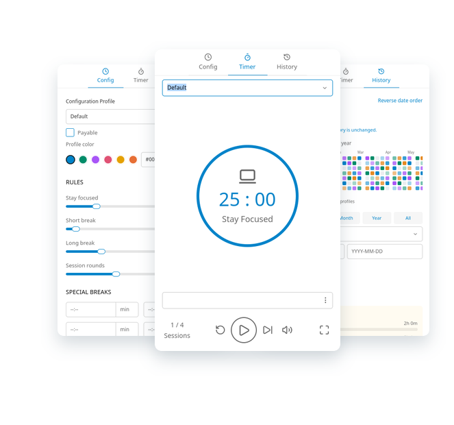

  

<h1 align="center">Pomoterra</h1>

<h3 align="center">Stay Focused. Take a Break.</h3>

  A compact Pomodoro timer built with Rust and NSH. 
  Make time for focused work, meaningful breaks, and better habits.

   
  <a href="#sparkles-features">Features</a>
  ·
  <a href="https://github.com/deltawenny/pomoterra/issues">Feedback</a>
  ·
  <a href="#computer-installation">Installation</a>
  ·
  <a href="#hammer_and_wrench-development">Development</a>
  ·
  <a href="#shield-privacy--storage">Privacy</a>
  ·
  <a href="#page_facing_up-license--credits">Credits</a>
   
   

  
  
  
  

  

## :sparkles: Features

- **A focused timer** — a blue countdown ring, start/pause, reset, skip, and full-screen controls. Start with 25 minutes of focus, 5-minute breaks, and a 15-minute break after every four focus sessions.

- **Your own rhythm** — customize focus time, short and long breaks, and the number of rounds. Sessions wait for Start by default; Settings can automatically continue after focus, breaks, or both.

- **Application settings** — choose completion notifications, bring the window forward after focus or breaks, control close-to-tray behavior, and pin profiles as quick-switch shortcuts. Settings persist across restarts and can be restored to defaults. English, Spanish, and Russian interfaces are available: select **Español** or **Русский** under **Settings → Language** to switch immediately, including tray menus and completion notifications. The language choice persists across restarts. Other language preferences currently fall back to English. Discord Rich Presence is not available yet.

- **Scheduled breaks** — set up to four daily breaks for lunch, a walk, or anything else. A scheduled break can interrupt an active focus session and preserve the remaining focus time for you to resume afterward.

- **Profiles for different kinds of work** — create, search, rename, and color-code profiles, each with its own timer rules and break schedule.

- **Session notes** — add context to your current focus session. Notes are saved to history when the focus period completes naturally.

- **History you can explore** — a contribution calendar, profile charts, date filters, and session totals help you see where your focus goes. Preview the interface with built-in sample history without changing your saved data.

- **Optional earnings tracking** — assign an hourly rate and currency to a profile. Completed sessions retain their original rate, and totals keep different currencies separate.

- **Local persistence** — profiles, settings, schedules, and completed sessions are saved in a local SQLite database.

- **Native desktop tray support** — packaged desktop builds keep working when you close the window to the system tray or menu bar. Timers and scheduled breaks continue while the window is hidden.

## :computer: Installation

Download a package for your system from the **[latest release](https://github.com/deltawenny/pomoterra/releases/latest)**.

| Platform | Architecture | Package |
| --- | --- | --- |
| Linux | x64 / ARM64 | Debian package or portable tar archive |
| Windows | x64 | Portable ZIP |
| macOS 14+ | Intel / Apple Silicon | DMG or app bundle ZIP |

- **Windows:** extract the ZIP before launching the app. Packages are unsigned.
- **macOS:** open the DMG and drag Pomoterra into Applications, or extract the app bundle ZIP. Choose the correct architecture. Builds are ad-hoc signed, not notarized; Gatekeeper may block them.
- **Linux:** use your distribution's package installer for the Debian package, or extract the archive. Builds target Ubuntu 24.04 and require Vulkan, Wayland or X11, and libxkbcommon; older distributions may not be compatible.

Every download includes a SHA-256 checksum. See the [installation and verification guide](docs/technical-guide.md#install-and-verify) for details and platform limitations.

> **Background operation:** with Close to Tray enabled (the default), closing the window hides the app to the system tray or macOS menu bar when a tray host is available. On Linux, a StatusNotifier-compatible tray host is required; if unavailable, closing exits normally. Native completion notifications depend on operating-system permissions and notification services.

## :hammer_and_wrench: Development

### Translations

Localization uses [rust-i18n](https://github.com/longbridge/rust-i18n), with compile-time
catalogs in [English](locales/en.json), [Spanish](locales/es.json), and
[Russian](locales/ru.json). No translation files are needed beside the packaged app.

- Add a stable message ID and its source text to the [English catalog](locales/en.json),
  then add translations under the same ID in the other catalogs. Missing translations
  fall back to English; unknown IDs are displayed unchanged.
- Use rust-i18n's percent-prefixed named placeholders, as demonstrated by the profile
  switching message in the [English catalog](locales/en.json). Keep placeholder names
  identical across languages. Inserted profile names and notes are never translated
  or reinterpreted as templates.
- The [reactive adapters](src/i18n/reactive.rs) track the saved language preference.
  Native integrations use the same [language adapter](src/i18n/language.rs) with an
  explicit locale, without changing process-global locale state.
- Rebuild after editing a catalog. The [localization tests](src/i18n/tests.rs) validate
  embedded lookups, placeholders, English fallback, live switching, and concurrent locales.

Pomoterra uses Rust, [NSH](https://nsh.dev/), and Toasty with bundled SQLite. Building requires **Rust 1.95 or newer** and the development libraries for your selected desktop backend.

Start with the [technical guide](docs/technical-guide.md) for native and GPUI build commands, Linux prerequisites, tests, database behavior, icons, and release packaging.

| Guide | What it covers |
| --- | --- |
| [Timer](docs/technical-guide.md#timer) | Controls, session notes, and phase behavior |
| [Background operation](docs/technical-guide.md#background-operation-and-tray) | Native tray integration and backend differences |
| [Configuration](docs/technical-guide.md#config) | Timer rules, profiles, and scheduled breaks |
| [History and storage](docs/technical-guide.md#history-and-storage) | Persistence, sample data, and development commands |
| [Screenshot preview](docs/screenshots.md) | Generate a layered README preview from real app screenshots |
| [Desktop builds](docs/technical-guide.md#gpui-host-and-local-builds) | GPUI builds and platform dependencies |
| [Releases](docs/technical-guide.md#publish-a-version) | Version tags, CI, and distribution |

Found a bug or have an idea? Open an [issue](https://github.com/deltawenny/pomoterra/issues) or submit a [pull request](https://github.com/deltawenny/pomoterra/pulls).

## :shield: Privacy & Storage

Your profiles and completed focus sessions are stored locally in SQLite, in your operating system's application data directory. No account is required to use the timer.

- Completed sessions retain their notes, focus duration, profile, and billing-rate snapshot.
- Unfinished countdowns and draft notes stay in memory and do not survive an app restart.
- Sample history is an in-memory preview and never changes your saved sessions.
- Storage errors appear in the app. Resolve them before quitting so pending session records can be saved.

See [history and storage](docs/technical-guide.md#history-and-storage) for database locations, storage overrides, and limitations.

## :page_facing_up: License & Credits

Pomoterra is licensed under the [MIT License](LICENSE). Third-party dependencies retain their respective licenses.

The Pomoterra logo is an original timer, terrain, and sprout design, representing time for growth.

Pomoterra uses [Lucide](https://lucide.dev/) icons. Dependency attribution and license texts are included in [third-party notices](THIRD_PARTY_NOTICES.md).

Pomoterra is inspired by [Pomatez](https://github.com/zidoro/pomatez), which also inspired this README's layout.

The preview shows real Pomoterra application screenshots; the History view uses built-in sample data. Refresh it with the [single-command preview tool](docs/screenshots.md).
